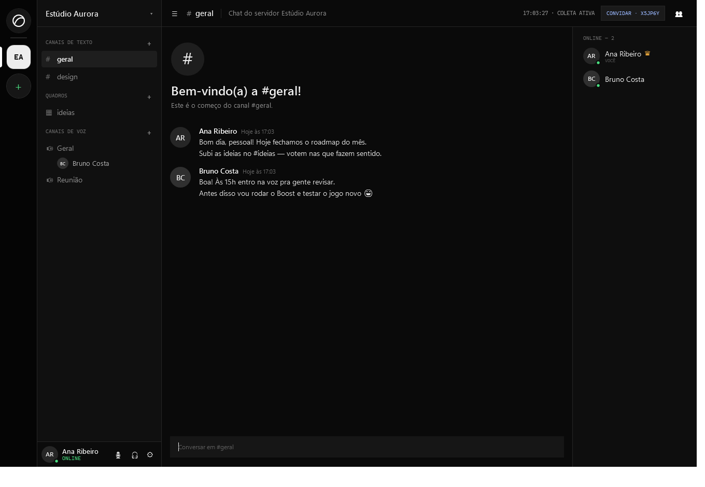
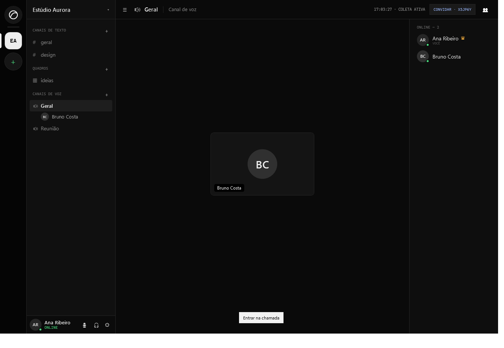
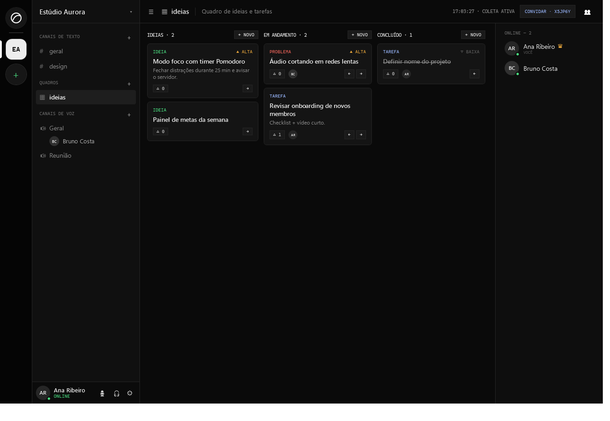
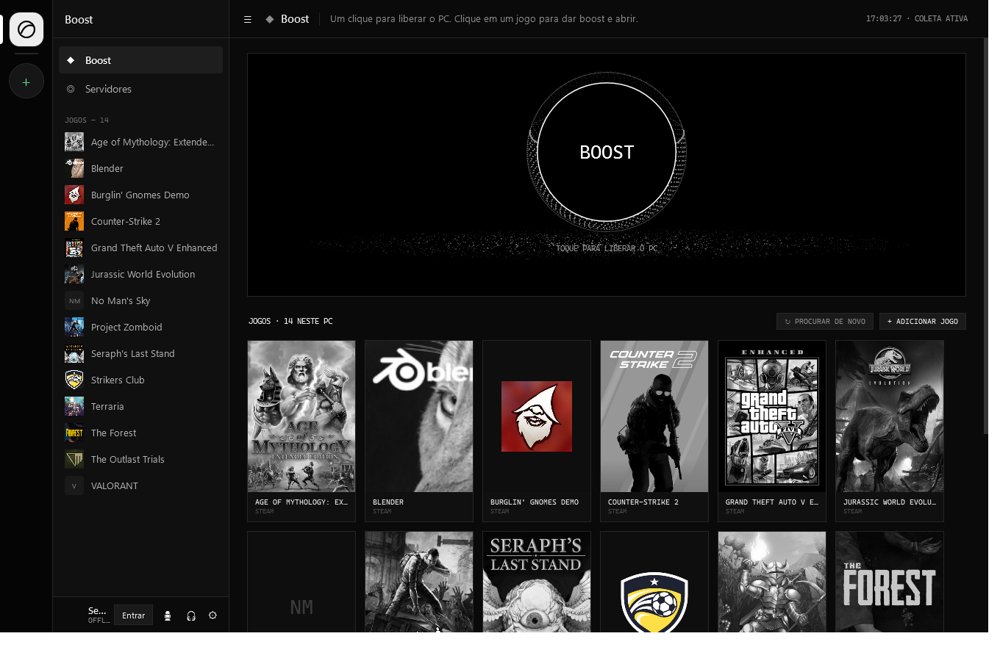
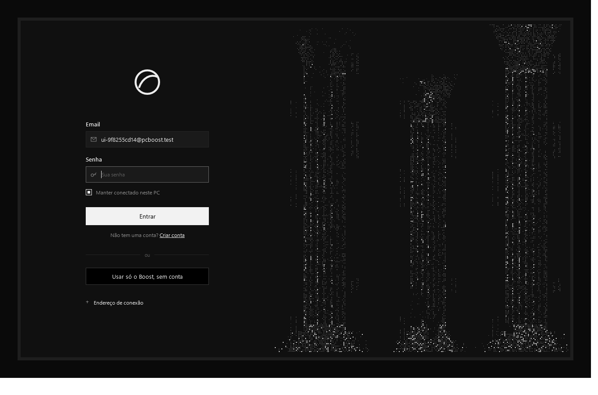

# Ximbuismo

Aplicativo Windows em português do Brasil que funciona como o Discord, com dois extras: **Boost** de PC para jogos e **quadros de ideias e tarefas** dentro dos servidores. Visual escuro, linhas finas e arte em pontos.

- **Trilho à esquerda:** o ícone do Boost no topo, os seus servidores e o **+** (criar ou entrar com código de convite).
- **Servidores:** canais de texto `#`, **quadros** de ideias/tarefas e canais de **voz** 🔊 (quem está na voz aparece embaixo do canal). Membros online/offline à direita. Painel do usuário embaixo, com microfone, fone e ⚙ configurações.
- **Boost:** um botão **BOOST** e a grade dos jogos instalados (Steam, Epic, GOG, Ubisoft, Riot e os que você adicionar). Clicar num jogo dá boost e abre o jogo. O boost é automático e reversível: modo de energia de desempenho (só quando o plano atual não é de desempenho, e só anunciado depois de confirmado), apps em segundo plano com prioridade "abaixo do normal" e memória ociosa devolvida ao Windows, e o jogo com prioridade alta. Nenhum app é fechado. Chat de voz, OBS, drivers, launchers e anti-cheat ficam de fora. Quando o jogo fecha, tudo volta ao normal sozinho. As telas detalhadas ficam em **⚙ → Avançado**.

O Boost funciona sem conta. Servidores, chat, voz e quadros usam o servidor online.







## Monorepo

```
apps/desktop      App Windows (WPF, .NET 8): Boost + cliente estilo Discord
apps/server       Servidor (ASP.NET Core 8 + SignalR + SQLite): contas, servidores, canais, chat, voz e quadros
apps/web          Site de download (HTML/CSS/JS estático), servido pelo próprio servidor em /
packages/shared   Contratos (DTOs) usados pelo app e pelo servidor
discloud.config  Configuração da Discloud na raiz (MAIN=start.py)
start.py         Lançador do servidor Linux em server/
requirements.txt Dependências do lançador Python
deploy/          Pacote ZIP gerado para a Discloud
scripts/          build-installer.ps1, publish-release.ps1 e deploy-discloud.ps1
docs/             Imagens e validação
PCBoost.sln       Solução com os três projetos
```

## Para quem usa: instalar

Baixe o **Ximbuismo-Setup.exe** no site (https://probable-app.discloud.dev), abra e clique em **Instalar**. Pronto: o app abre, você cria a conta e usa. Não precisa instalar .NET, abrir `.bat` nem configurar servidor.
O instalador não pede administrador: coloca o app em `%LOCALAPPDATA%\Programs\Ximbuismo`, cria atalhos (Menu Iniciar e, se quiser, Área de Trabalho) e aparece como **Ximbuismo** em **Configurações do Windows → Aplicativos** para desinstalar.

## Publicar: servidor na Discloud + instalador

A Discloud não roda .NET nativamente. Por isso o servidor vai **compilado como executável Linux autocontido** (com o .NET dentro), e o `start.py` na raiz só o inicia na porta 8080 que a Discloud exige para sites.

O `discloud.config`, o `start.py` e o `requirements.txt` ficam na raiz do projeto. Use o ZIP gerado abaixo para publicar: clonar este repositório na Discloud não inclui `server/`, pois os binários compilados são ignorados pelo Git.

1. **Gere o pacote:**
   ```powershell
   powershell -ExecutionPolicy Bypass -File scripts/deploy-discloud.ps1
   ```
   Sai `deploy/pcboost-discloud.zip`, com `discloud.config`, `start.py` e a pasta `server/` na raiz.
2. **Envie o .zip** pelo painel da Discloud ou pela CLI (`discloud upload`, e `discloud commit` nas atualizações). O [discloud.config](discloud.config) usa `TYPE=site` e `ID=probable-app`, então o endereço fica `https://probable-app.discloud.dev`. Sites na Discloud pedem o **plano Platinum** e pelo menos **512 MB de RAM**. O subdomínio `probable-app` precisa estar livre na sua conta; se escolher outro, troque `ID` e o endereço do passo 3.
3. **Teste** `https://probable-app.discloud.dev/api/health`. Deve responder `{"ok":true,...}`.
4. **Gere o instalador apontando para ele** (o endereço fica gravado no app e o campo de endereço some da tela de entrada):
   ```powershell
   powershell -ExecutionPolicy Bypass -File scripts/build-installer.ps1 -ServerUrl https://probable-app.discloud.dev
   ```
   Distribua `installer/Ximbuismo-Setup.exe` pelo site (abaixo).

### Site de download

O servidor também serve o site em `/` (código em [apps/web](apps/web)). O botão **Baixar** aponta para `/download`, que entrega o instalador assim:

1. se existir `downloads/Ximbuismo-Setup.exe` ao lado do servidor (ou na pasta de `PCBOOST_DOWNLOADS`), envia o arquivo;
2. senão, redireciona para `PCBOOST_DOWNLOAD_URL`.

Na Discloud o .exe (~70 MB) não cabe junto com o servidor no limite de 100 MB do .zip. Por isso o `start.py` aponta `PCBOOST_DOWNLOAD_URL` para o anexo da última release do GitHub, e o instalador é publicado com:
```powershell
powershell -ExecutionPolicy Bypass -File scripts/publish-release.ps1
```
O script gera o instalador e cria (ou atualiza) a release `v<Version>` com o `Ximbuismo-Setup.exe`. O repositório precisa ser **público** para qualquer pessoa baixar o anexo. Para manter o código privado, crie um repositório público só para releases, passe `-Repo dono/repo` ao script e troque o endereço em `PCBOOST_DOWNLOAD_URL` no `start.py`.

O banco SQLite fica em `data/pcboost-team.db` dentro da aplicação na Discloud. Faça backup antes de apagar ou recriar a aplicação. Bancos da versão anterior são migrados sozinhos: cada servidor ganha `#geral`, `#ideias` e o canal de voz `Geral`, com as mensagens e ideias antigas.

Fora da Discloud, o servidor também roda em Docker (`docker build -f apps/server/Dockerfile -t pcboost-server .`) ou em qualquer host .NET 8. Ele usa a porta da variável `PORT`, o banco em `PCBOOST_DATA`, o instalador em `PCBOOST_DOWNLOADS` ou `PCBOOST_DOWNLOAD_URL`, e entende HTTPS atrás de proxy.

## Servidores: como funciona

- **Contas:** e-mail + senha (mínimo 8 caracteres). Senhas com PBKDF2-SHA512 e sal; tokens aleatórios de 30 dias, revogados ao sair. "Manter conectado" guarda o token protegido por DPAPI (só seu usuário do Windows o lê). Login e cadastro limitados a 10 tentativas por minuto por IP.
- **Servidores e canais:** quem cria é o dono e o único que cria ou apaga canais (o último canal de texto não pode ser apagado). Convite por código de 6 caracteres. Se o dono sair, o membro mais antigo assume; quando o último membro sai, o servidor é apagado.
- **Chat:** em tempo real via SignalR, por canal, histórico paginado (80 por vez), mensagens agrupadas por autor, presença online/offline, contador de não lidas por canal.
- **Voz:** por canal de voz, como no Discord: clique no canal para entrar. Áudio PCM 16 kHz mono (NAudio); silêncio não é enviado; o servidor só repassa o áudio, sem gravar. Mudo, ensurdecer, anel verde em quem está falando. A voz continua enquanto você navega. Feita para grupos pequenos (~32 KB/s por pessoa falando, sem criptografia ponta a ponta).
- **Quadros:** cada item tem título, descrição, tipo (ideia/tarefa/problema), prioridade, status e responsável; mova com ← →, vote com △. Mudanças aparecem para todos na hora.

## Telas avançadas do Boost (⚙ → Avançado)

- **Visão geral:** RAM disponível, RAM em uso, comprometimento/limite, gráfico e maiores consumidores.
- **Diagnóstico:** regras de tendência, pools, cache e processos com PID, RAM privada residente, memória privada comprometida e variação. O agrupamento usa relações conhecidas entre pais e filhos. Métrica indisponível aparece explicitamente, sem virar zero.
- **Trabalho:** mesmas regras do perfil Desenvolvimento (IDE, terminais e agentes protegidos) para fechar distrações antes de trabalhar.
- **Jogos:** selecione o executável e configure os argumentos como lista JSON, por exemplo `["--fullscreen"]`. Abra as regras, escolha os candidatos e marque individualmente quem pode receber um pedido de fechamento normal. **Preparar e abrir jogo** aplica essa revisão e inicia o jogo/launcher.
- **Desenvolvimento:** cadastre um projeto, revise a configuração detectada e clique em **Checar ambiente** / **Testar plugin**. Os campos avançados ficam no painel de configuração do projeto.
- **Histórico:** sessões e evidências locais.
- **Configurações:** intervalos de coleta, retenção e limites dos alertas.

Os perfis começam preservando tudo. Regras de fechamento ainda exigem seleção na revisão. Aplicativos externos recebem somente fechamento normal e podem exibir sua própria confirmação de trabalho não salvo. PID, horário de início e caminho são revalidados. Processos protegidos, ferramentas de segurança, Windows e o próprio booster são preservados; IDE, terminais, agentes e seus descendentes conhecidos também são protegidos no perfil Desenvolvimento. Processos iniciados pelo app ficam em jobs próprios do Windows. A parada forçada exige uma tentativa normal e outro botão de confirmação, e alcança somente esses jobs.

Após aplicar um perfil, o app mostra RAM disponível antes/depois, horários e variação observada. Essa variação inclui outras atividades do Windows; o consumo listado por processo não é uma promessa de memória recuperável.

## Configurar um plugin Minecraft

1. Selecione pasta do projeto, `java.exe` do JDK, pasta dedicada de servidor e JAR do servidor. Use **Detectar comandos** para Gradle/Maven; wrappers locais têm preferência. Revise executáveis e argumentos JSON antes de salvar.
2. Configure build e testes separadamente. Os padrões são Gradle `--no-daemon assemble` + `--no-daemon test`, ou Maven `package -DskipTests` + `test`. Sem wrapper, a ferramenta precisa estar no PATH ou ter caminho absoluto.
3. Configure Xms/Xmx, margem fora do heap, RAM mínima para build e margem de comprometimento. Configure portas como `tcp:25565` ou `udp:19132`.
4. Use uma pasta exclusivamente de teste. Prepare nela a distribuição do servidor e seus arquivos necessários. O app não fornece servidor, não aceita EULA e não altera o projeto automaticamente.
5. Configure o padrão de prontidão de acordo com o servidor. O padrão inicial corresponde ao log usual de Paper. Configure separadamente o padrão de plugin carregado; vazio significa **inconclusivo**. Um padrão deve identificar evidência real do seu plugin. Compatibilidade com Paper/PowerNukkitX depende de JDK, API, projeto e artefato escolhidos.
6. Clique em **Testar plugin**. O app verifica ambiente/memória, executa Java, build e testes sequencialmente, mede memória novamente, instala o plugin com backup e inicia o servidor. Mais de um JAR pede seleção. Falta de margem permite revisar apps, tentar novamente ou prosseguir explicitamente com ambiente válido.
7. Acompanhe log, código de saída, duração e evidências por etapa. **Testes passaram** exige relatórios JUnit recentes com testes executados e sem falhas, ou o padrão confirmatório configurado. Código zero sozinho deixa o resultado inconclusivo. Use **Parar** ao terminar.

A substituição do JAR usa arquivo temporário no destino, backup da versão anterior e renomeação. O ambiente fica bloqueado contra sessões simultâneas do Ximbuismo. Portas são verificadas antes de executar; outro programa ainda pode ocupá-las depois da checagem, caso em que o log orienta o diagnóstico.

## Métricas e dados locais

Coleta física via GlobalMemoryStatusEx, comprometimento/pools/cache via GetPerformanceInfo e memória privada por contadores nativos de processo. RAM em uso e memória comprometida são conceitos diferentes e não são somadas. A lista de processos não explica sozinha memória de kernel, páginas compartilhadas ou cache. Standby e reservada para hardware ficam indisponíveis quando a fonte usada não fornece um valor confiável. Há atalho para a orientação oficial do RAMMap.

Padrões: métricas a cada 5 s, processos a cada 20 s somente em primeiro plano, métricas a cada 30 s em segundo plano. Histórico de memória: até 24 h e 20 mil amostras; sessões: últimas 200. Configurações e histórico ficam em **%LOCALAPPDATA%\\PCBoost\\workspace**. Logs: até 128 KB em memória, segmentos de até 1 MB, aproximadamente 40 arquivos recentes. O teste de interface usa estado isolado dentro da pasta do executável.

As telas avançadas não executam limpeza de cache/arquivos nem ajustes de serviços, registro, paginação ou segurança. O botão **BOOST** é o único fluxo que mexe no sistema, e só de forma reversível: modo de energia, prioridade de processos e devolução de memória ociosa (working set).

## Desenvolver, compilar e verificar

```powershell
dotnet build PCBoost.sln -c Release
dotnet run --project apps/server                     # servidor local em http://localhost:5080
dotnet run --project apps/desktop                    # app (usa http://localhost:5080 por padrão)
dotnet publish apps/desktop -c Release -o dist --no-self-contained
Start-Process .\dist\Ximbuismo.exe --self-test -Wait
Start-Process .\dist\Ximbuismo.exe --ui-test -Wait
Start-Process .\dist\Ximbuismo.exe --boost-test -Wait          # liga e desliga o Boost e confere a restauração
Start-Process .\dist\Ximbuismo.exe --integration-test -Wait
Start-Process .\dist\Ximbuismo.exe --idle-test -Wait
# Com o servidor rodando: dois clientes reais testam contas, servidores, canais, chat, quadro, voz e presença
Start-Process .\dist\Ximbuismo.exe '--team-test http://localhost:5080' -Wait
# UI completa incluindo servidores (gera capturas *-preview.png)
$env:PCBOOST_TEAM_TEST='http://localhost:5080'; Start-Process .\dist\Ximbuismo.exe --ui-test -Wait
```

Confira os arquivos `*-test-result.txt` na pasta de trabalho. A integração requer JDK com javac/jar, Maven no PATH e dependências locais JUnit 5.12.2 e plugins Maven indicados em IntegrationTests.cs; usa modo offline. O caso Gradle usa uma distribuição em cache ou o caminho em **PCBOOST_TEST_GRADLE**; usa Maven Local para JUnit. Se não houver Gradle, registra SKIP. Não baixa ferramentas ou servidores. Fixtures e logs ficam em `dist/verification/<sessão>`.

Consulte [docs/VALIDATION.md](docs/VALIDATION.md) para resultados, escopo e passos de validação em servidor real.

Referências das fontes: [GlobalMemoryStatusEx](https://learn.microsoft.com/en-us/windows/win32/api/sysinfoapi/nf-sysinfoapi-globalmemorystatusex), [GetPerformanceInfo](https://learn.microsoft.com/en-us/windows/win32/api/psapi/nf-psapi-getperformanceinfo), [PROCESS_MEMORY_COUNTERS_EX2](https://learn.microsoft.com/en-us/windows/win32/api/psapi/ns-psapi-process_memory_counters_ex2), [RAMMap](https://learn.microsoft.com/en-us/sysinternals/downloads/rammap).
